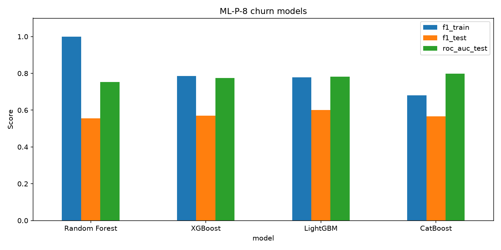
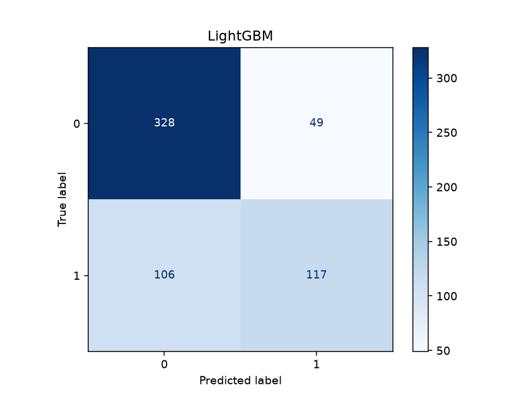
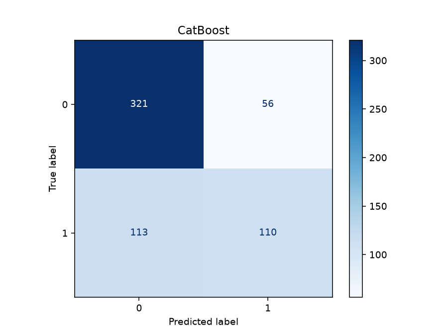

# Практическая работа №8: Градиентный бустинг и сравнение моделей

**Вариант:** Уровни A, B и C (основное задание и открытое сравнение библиотек)  
**Репозиторий:** [ibrodevs/ML-P-8](https://github.com/ibrodevs/ML-P-8.git)  
**Студент:** Иброхим Абдраимов (`ibrodevs`)  
**Группа:** CS-32-24  

---

## Обоснование выбора окружения

Работа выполнена на **Python 3** с использованием `pandas`, `scikit-learn`, `xgboost`, `lightgbm`, `catboost` и `matplotlib`. Для оформления результатов используются Jupyter Notebook и `python-pptx`.

Цель работы — спрогнозировать отток абонентов мобильного оператора и сравнить **Random Forest, XGBoost, LightGBM и CatBoost** на одинаковых данных. Случайный лес служит базовым ансамблем; три библиотеки бустинга сравниваются по качеству, времени обучения, скорости предсказания и размеру обученной модели.

Для корректности сравнения все методы используют одно фиксированное разбиение `train/test` с `random_state=42`. Каждая модель создаётся заново, без повторного использования уже обученного препроцессора.

---

## Структура репозитория

```text
ML-P-8/
├── o_churn_synthetic.csv           # Исходный датасет (3000 абонентов)
├── ML_P8.ipynb                     # Эксперимент по каждому методу
├── scripts/
│   ├── run_experiment.py           # Обучение 4 моделей и сравнение
│   └── make_presentation.py        # Генерация презентации
├── outputs/
│   ├── metrics.csv                 # Таблица всех результатов
│   ├── metrics.json                # Метрики, параметры замеров, версии
│   ├── report.md                   # Автоматический текстовый отчёт
│   ├── comparison.png              # Сравнительная диаграмма
│   ├── random_forest_confusion.png # Матрица ошибок Random Forest
│   ├── xgboost_confusion.png       # Матрица ошибок XGBoost
│   ├── lightgbm_confusion.png      # Матрица ошибок LightGBM
│   └── catboost_confusion.png      # Матрица ошибок CatBoost
├── presentation/
│   ├── ML_P8_Comparison.pptx       # 12 слайдов: по 3 на метод
│   └── speaker_notes.md            # Текст для выступления
├── .github/workflows/ml-report.yml # Автоматический запуск и публикация
├── requirements.txt                # Зависимости проекта
└── README.md                       # Основной оформленный отчёт
```

---

## Инструкция по установке и запуску

### 1. Клонирование

```bash
git clone https://github.com/ibrodevs/ML-P-8.git
cd ML-P-8
```

### 2. Создание окружения

**Linux / macOS:**

```bash
python3 -m venv .venv
source .venv/bin/activate
pip install -r requirements.txt
```

**Windows:**

```powershell
python -m venv .venv
.venv\Scripts\activate
pip install -r requirements.txt
```

### 3. Запуск эксперимента

```bash
python scripts/run_experiment.py
```

Скрипт обучает все четыре модели, сохраняет метрики, матрицы ошибок и сравнительную диаграмму в `outputs/` и обновляет итоговую таблицу этого README.

### 4. Генерация презентации

```bash
python scripts/make_presentation.py
```

Презентация создаётся в `presentation/ML_P8_Comparison.pptx`: **12 слайдов — по 3 слайда на Random Forest, XGBoost, LightGBM и CatBoost**. Общая рекомендация приведена в заключительном слайде.

### 5. Проверка Notebook

```bash
jupyter notebook
```

Откройте `ML_P8.ipynb` и выберите **Restart & Run All**. Проверка выполнения Notebook с чистого ядра также включена в GitHub Actions и прошла успешно.

---

## Краткое описание набора данных

Используется файл [`o_churn_synthetic.csv`](o_churn_synthetic.csv) с синтетическими данными абонентов:

- **3000 объектов**;
- **11 входных признаков** после удаления идентификатора `subscriber_code`;
- **целевой признак** `churn`: `1` — абонент ушёл, `0` — остался;
- **1886 объектов класса 0**, **1114 объектов класса 1**;
- **2400 записей train** и **600 записей test** (80/20).

Входные признаки:

```text
region                # Регион
tariff                # Тариф
tenure_months         # Стаж абонента (месяцы)
monthly_charge_som    # Ежемесячный платёж (сом)
internet_gb           # Потребление интернета
support_calls_3m      # Обращения в поддержку за 3 месяца
autopay               # Автоматическая оплата
days_since_topup      # Дней после пополнения
topups_3m             # Пополнения за 3 месяца
dropped_calls_pct     # Процент прерванных вызовов
balance_som           # Баланс (сом)
```

Разделение выполнено с `stratify=y` и `random_state=42`, чтобы все алгоритмы проверялись на одних и тех же объектах с сохранением доли классов.

---

## Выполнение задания

### 1. Подготовка данных

Из входных данных исключаются `churn` (цель) и `subscriber_code` (идентификатор, не признак поведения). Для `Random Forest`, `XGBoost` и `LightGBM` используется отдельный `Pipeline` с `OneHotEncoder(handle_unknown="ignore")` для колонок `region` и `tariff`.

**CatBoost** получает `region` и `tariff` как нативные категориальные признаки. Это позволяет сравнить его собственный механизм работы с категориями с использованием one-hot кодирования в других библиотеках.

### 2. Random Forest — базовый ансамбль

Обучен `RandomForestClassifier` с параметрами:

```python
RandomForestClassifier(n_estimators=100, random_state=42, n_jobs=1)
```

Результат:

```text
F1 train     = 1.000
F1 test      = 0.556
ROC-AUC test = 0.752
```

Высокий F1 на обучении и значительно меньший F1 на тесте указывают на **переобучение**: разрыв составляет **0.444**. Поэтому случайный лес полезен как базовый ориентир, но в этой конфигурации не является лучшим вариантом.

### 3. XGBoost — градиентный бустинг

Параметры:

```python
XGBClassifier(
    n_estimators=300, learning_rate=0.05,
    max_depth=4, random_state=42, n_jobs=1,
    eval_metric="logloss"
)
```

Результат:

```text
F1 train     = 0.786
F1 test      = 0.571
ROC-AUC test = 0.775
```

По сравнению со случайным лесом XGBoost улучшил тестовые F1 и ROC-AUC. Разрыв F1 между обучением и тестом снизился до **0.216**.

### 4. LightGBM — бустинг с быстрым обучением

Параметры:

```python
LGBMClassifier(
    n_estimators=300, learning_rate=0.05,
    max_depth=4, num_leaves=15,
    random_state=42, n_jobs=1
)
```

Результат:

```text
F1 train     = 0.778
F1 test      = 0.602
ROC-AUC test = 0.781
```

LightGBM показывает **лучший F1 на test** среди четырёх моделей. Он также оказался самым быстрым по медианному времени обучения в проведённых замерах. Разрыв F1 — **0.176**.

### 5. CatBoost — работа с категориальными признаками

Параметры:

```python
CatBoostClassifier(
    iterations=300, learning_rate=0.05,
    depth=4, random_seed=42,
    cat_features=["region", "tariff"],
    thread_count=1, verbose=False
)
```

Результат:

```text
F1 train     = 0.681
F1 test      = 0.566
ROC-AUC test = 0.798
```

CatBoost показал **лучший ROC-AUC test (0.798)**, самый небольшой разрыв F1 (**0.116**), самый маленький размер модели и самый быстрый пакетный инференс в данном замере. Его преимущество по ROC-AUC означает лучшее ранжирование абонентов по риску оттока, но не обязательно лучший F1 при стандартном пороге 0.5.

### 6. Сводное сравнение качества и ресурсов

Все значения рассчитаны на **одном исходном CSV**. Сравнивались F1 на обучении и тесте, ROC-AUC test, медиана времени обучения, время предсказания для 600 тестовых объектов и размер сериализованной модели.

<!-- METRICS_START -->
### Результаты по исходному CSV

| Модель | F1 train | F1 test | ROC-AUC test | Обучение, с | Инференс, с | Размер, КБ | Δ F1 |
|---|---:|---:|---:|---:|---:|---:|---:|
| Random Forest | 1.000 | 0.556 | 0.752 | 0.327 | 0.01727 | 8273.6 | 0.444 |
| XGBoost | 0.786 | 0.571 | 0.775 | 0.132 | 0.00384 | 444.1 | 0.216 |
| LightGBM | 0.778 | **0.602** | 0.781 | **0.080** | 0.01011 | 415.3 | 0.176 |
| CatBoost | 0.681 | 0.566 | **0.798** | 0.682 | **0.00092** | **115.6** | **0.116** |

**Лучший бустинг по ROC-AUC test:** CatBoost (0.798). **Лучший по F1 test:** LightGBM (0.602).

**Методика времени:** 1 поток, первый обучающий прогон исключён, медиана следующих 5 запусков. Инференс — медиана 5 замеров на 600 тестовых строк после прогрева. Размер — `pickle` обученной модели (включая `Pipeline` для моделей с one-hot). Время зависит от оборудования.

<!-- METRICS_END -->

### 7. Графики и матрицы ошибок

Сравнительная диаграмма четырёх моделей:



Матрицы ошибок на тестовой выборке:

| Random Forest | XGBoost |
|---|---|
|  |  |
| LightGBM | CatBoost |
|  |  |

Графики помогают увидеть различия в качестве; матрицы ошибок показывают, сколько объектов каждого класса предсказано верно и неверно.

### 8. Честное сравнение времени и размера

Для всех алгоритмов используется **один поток** (`n_jobs=1`; для CatBoost `thread_count=1`). Каждый метод обучается заново несколько раз. Первый прогон исключён из расчёта времени, а результат — медиана следующих пяти замеров.

Скорость инференса измеряется по `predict_proba` для **всех 600 тестовых строк**. Размер модели определяется размером `pickle`-представления обученного классификатора вместе с препроцессором там, где он используется.

Важно: один и тот же train/test split обеспечивает сопоставимость метрик, но разные способы обработки категорий и настройки моделей сохраняются. Замеры на одном компьютере не гарантируют такой же скорости на другом.

### 9. Версии библиотек и воспроизводимость

Версии в успешном запуске GitHub Actions:

```text
scikit-learn = 1.8.0
xgboost      = 3.2.0
lightgbm     = 4.7.0
catboost     = 1.2.10
```

Точные версии текущего запуска и параметры сравнения сохраняются в [`outputs/metrics.json`](outputs/metrics.json). Notebook также выводит версии библиотек. GitHub Actions проверяет выполнение Notebook с чистого ядра и генерирует PowerPoint.

---

## Ключевые результаты

- **Random Forest:** F1 test **0.556**, ROC-AUC test **0.752**; заметное переобучение (`F1 train = 1.000`).
- **XGBoost:** F1 test **0.571**, ROC-AUC test **0.775**; оба результата выше Random Forest.
- **LightGBM:** **лучший F1 test = 0.602** и самое быстрое обучение (**0.080 с**) в проведённых замерах.
- **CatBoost:** **лучший ROC-AUC test = 0.798**, самый малый разрыв F1 (**0.116**), размер модели **115.6 КБ**.
- Разбиение: **2400 / 600**, `random_state=42`, `stratify=y`.
- Для времени: **1 поток**, **5 замеров**, медиана после исключения первого прогона.
- Презентация: **12 слайдов**, по **3 на каждый из 4 методов**.

---

## Вывод

Было выполнено сравнение четырёх ансамблевых алгоритмов прогнозирования оттока на одном наборе из 3000 абонентов. **Random Forest** сильно переобучился и уступил бустингам по тестовым метрикам. **XGBoost** улучшил качество относительно случайного леса. **LightGBM** показал наивысший F1 test и минимальное время обучения в измеренной среде. **CatBoost** продемонстрировал наибольший ROC-AUC test, самый маленький разрыв между F1 train/test и эффективную работу с категориальными признаками.

**Рекомендация:** для ранжирования абонентов по вероятности оттока предпочтителен **CatBoost** (ROC-AUC = 0.798); если основная цель — максимизировать F1 при используемом пороге классификации, лучше **LightGBM** (F1 test = 0.602). Перед применением в реальной системе следует дополнительно проверить качество кросс-валидацией, подобрать порог и учесть стоимость ошибок первого и второго рода.
